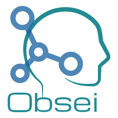
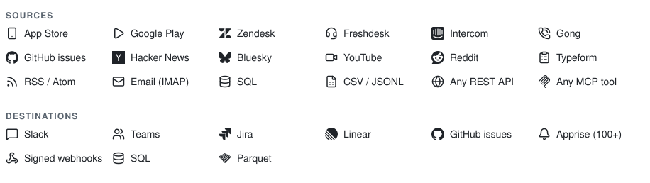

<p align="center">
  
</p>

<h1 align="center">obsei</h1>

<p align="center"><b>Know what customers are saying. Keep what they said private.</b><br>
The self-hosted, open source alternative to Enterpret and Unwrap that strips PII before any LLM sees it.<br>Bring your own sources, models and agents.</p>

<p align="center">
  <a href="https://docs.obsei.com/">Docs</a> ·
  <a href="https://docs.obsei.com/demo/">Live demo</a> ·
  <a href="https://obsei.com/">Website</a> ·
  <a href="https://blog.obsei.com/">Blog</a> ·
  <a href="https://github.com/obsei/obsei/discussions">Discussions</a>
</p>

<p align="center">
  <a href="https://github.com/obsei/obsei/actions/workflows/ci.yml"></a>
  <a href="https://pypi.org/project/obsei/"></a>
  <a href="https://github.com/obsei/obsei/pkgs/container/obsei"></a>
  <a href="https://scorecard.dev/viewer/?uri=github.com/obsei/obsei"></a>
  <a href="https://github.com/obsei/obsei/blob/master/LICENSE"></a>
</p>

---

Teams want to understand what customers say in reviews, tickets, calls and surveys, but often can't
send that text to another SaaS or a public LLM. obsei runs entirely inside your own infrastructure:

- **Private by design.** PII is redacted (and optionally names) and authors are pseudonymised at
  ingest. Encrypted database, model and sink traffic air-gapped by default, no telemetry, erasure and an audit log built in.
- **Bring your own.** Your sources, your keys and your model: a zero-shot classifier that runs
  in process by default, a decision model such as Julia-1, or Ollama, vLLM, Azure OpenAI, OpenAI,
  Bedrock and Vertex through LiteLLM.
- **AI-native.** An MCP server and a Claude plugin, so agents answer questions about
  customers with cited, privacy-filtered evidence and propose issues that you approve.
- **Many languages.** Feedback is classified and quoted in its own language. With
  `obsei[embeddings]`, a local multilingual model groups the same issue across 50+ languages;
  without it, the offline embedder groups by wording, so each language forms its own themes.

obsei provides controls that *support* compliance with laws such as the GDPR, India's DPDP Act,
Brazil's LGPD and California's CCPA. It makes no compliance claims; you remain the data controller.

> [!NOTE]
> 1.0 is a new codebase, not compatible with 0.0.x. The legacy 0.0.x toolkit lives on the `legacy/0.0.x`
> branch (`pip install "obsei<1"`); see [Migrate from 0.0.x](https://docs.obsei.com/guides/migrate-from-0-0/).

## Quickstart

```bash
mkdir voc && cd voc
uvx --from "obsei[recommended]>=1.0" obsei init   # obsei.yaml, secrets, sample data, local model
obsei try                              # table of redacted, labelled feedback; nothing stored
obsei try https://apps.apple.com/us/app/whatsapp-messenger/id310633997   # or GitHub, HN, a feed, a CSV
obsei add appstore                     # add sources and sinks without editing YAML (obsei integrations)
obsei add slack                        # asks for the webhook, keeps it in .obsei/secrets.env
obsei check                            # every source and sink: secrets, egress, credentials
obsei run                              # fetch, redact, label, deliver, store
obsei serve                            # scheduled pipelines, webhooks, MCP and Studio
obsei doctor                           # environment, secrets, encryption, egress mode, plugins
```

`obsei[recommended]` is the full local setup (the classifier and multilingual themes); `obsei` alone
is enough for redaction, sources and sinks. To keep the `obsei` command, install it once:
`uv tool install "obsei[recommended]"` (or `pip install`). `obsei init` writes a random database key and pseudonym salt to
`.obsei/secrets.env` (owner-only, git-ignored), and every command loads it; on servers and in CI,
set `OBSEI_DB_KEY` and `OBSEI_PSEUDONYM_SALT` instead, or mount the file. With `obsei[local]`, the
`classify` enricher labels sentiment, intent and language on the CPU with no model server. A
[decision model](https://docs.obsei.com/guides/models/#decision-models) on
llama.cpp or any OpenAI-compatible endpoint also works: Ollama, vLLM, Azure OpenAI, OpenAI, Mistral,
or a LiteLLM proxy for Bedrock and Vertex ([benchmark](https://docs.obsei.com/guides/models/#benchmark)).
Public endpoints are refused until you choose `OBSEI_EGRESS_MODE=private` (with `OBSEI_EGRESS_ALLOW`)
or `hybrid`.

<picture>
  <source media="(prefers-color-scheme: dark)" srcset="docs/public/brand/integrations-dark.svg">
  
</picture>

| | Built in |
| --- | --- |
| Sources | CSV, JSON Lines, declarative REST, webhooks, App Store (any country), App Store Connect, Google Play (official API), GitHub issues, Hacker News, Bluesky, YouTube, RSS/Atom, SQL databases and warehouses, file drops, IMAP mailboxes, any MCP server, Zendesk, Freshdesk, Intercom, Gong; Reddit as an unpublished community plugin (install from Git) |
| Enrichers | Classification with an in-process zero-shot model (default), a decision model (Julia-1, Clef) or an LLM: sentiment, intent, language and custom choice, score and yes/no fields with confidence; low-confidence answers go to a stronger model or human review; `filter` drops or tags spam and off-topic records |
| Sinks | Signed webhooks (Standard Webhooks, CloudEvents) with retries, Slack, Telegram, Discord, email and Teams via Apprise (`obsei[notify]`), GitHub issues, Jira, Linear, Parquet, SQL databases and warehouses; ordered routes on labels, confidence and scores ([routing](https://docs.obsei.com/guides/routing/)) |
| Analysis | Stable themes (offline, or multilingual with `obsei[embeddings]`) with near-duplicate detection, k-anonymous themes, `obsei ask` with cited answers and an optional grounding judge, read-only Studio with a knowledge-graph explorer and privacy, decisions, trends and routes panels ([demo](https://docs.obsei.com/demo/)), Slack `/obsei` command, [alerts](https://docs.obsei.com/guides/alerts/) on theme spikes, new themes, digests, the review queue and pipeline health |
| Privacy | Redaction of emails, phones, cards and IBANs, plus national IDs for 16 countries in the Americas, Europe, Asia-Pacific and Africa, checksum-validated where the format has one, in any script; optional name redaction (`obsei[names]`); salted author pseudonyms; encrypted DuckDB; `obsei forget`, `obsei export` and `obsei audit` |
| Server | `obsei serve`: scheduled pipelines, signed webhook intake, MCP over HTTP, Studio, role-based access and SSO-proxy support |

Agents: `obsei mcp` serves MCP tools (read-only, plus proposals you approve); the Claude Code plugin is
`/plugin marketplace add obsei/obsei`. See the [docs](https://docs.obsei.com/) and
[integrations](integrations/README.md).

Examples: ready-to-run configs for app reviews in many countries, helpdesks, support-ticket triage
with a decision model and routes, social listening,
REST APIs (Trustpilot, HubSpot, ServiceNow, Mastodon), warehouses, mailboxes and air-gapped
enterprise setups are in the [examples gallery](https://docs.obsei.com/examples/).

Docker (run in the project directory; images are tagged by release):

<!-- x-release-please-start-version -->
```bash
docker run --rm -v "$PWD:/data" -w /data --user "$(id -u):$(id -g)" \
  ghcr.io/obsei/obsei:1.1.1 run   # reads .obsei/secrets.env, or pass -e OBSEI_DB_KEY ...
```
<!-- x-release-please-end -->

## Use it from your AI tool

The MCP server and `voice-of-customer` skill install straight from this repository (obsei isn't
in any tool's official plugin directory yet):

| Tool | Install |
| --- | --- |
| Claude Code | `/plugin install obsei --marketplace obsei/obsei` |
| Codex | `codex plugin marketplace add obsei/obsei`, then `codex plugin add obsei@obsei` |
| GitHub Copilot CLI | `copilot plugin install obsei/obsei:integrations/claude/obsei` |
| Gemini CLI | `gemini extensions install https://github.com/obsei/obsei` |
| Any MCP client | `uvx --from "obsei>=1.0" obsei mcp` |

[](https://cursor.com/install-mcp?name=obsei&config=eyJjb21tYW5kIjoidXZ4IiwiYXJncyI6WyItLWZyb20iLCJvYnNlaT49MS4wIiwib2JzZWkiLCJtY3AiXX0%3D)
[](https://insiders.vscode.dev/redirect/mcp/install?name=obsei&config=%7B%22command%22%3A%22uvx%22%2C%22args%22%3A%5B%22--from%22%2C%22obsei%3E%3D1.0%22%2C%22obsei%22%2C%22mcp%22%5D%7D)

VS Code, Devin Desktop, Zed, JetBrains, Kiro, Goose, Cline and ChatGPT: see
[AI tools](https://docs.obsei.com/guides/ai-tools/).

## Roadmap

Phases 0.1 to 0.5 (private core, MCP and Claude plugin, enterprise bring-your-own, themes and
Studio, decision models and routing) shipped in 1.0. See [ROADMAP.md](ROADMAP.md) for what is next.

## Contributing

Questions and ideas go to [Discussions](https://github.com/obsei/obsei/discussions). See
[CONTRIBUTING.md](CONTRIBUTING.md) for setup, conventions and the DCO sign-off.

## License

[Apache-2.0](LICENSE)
